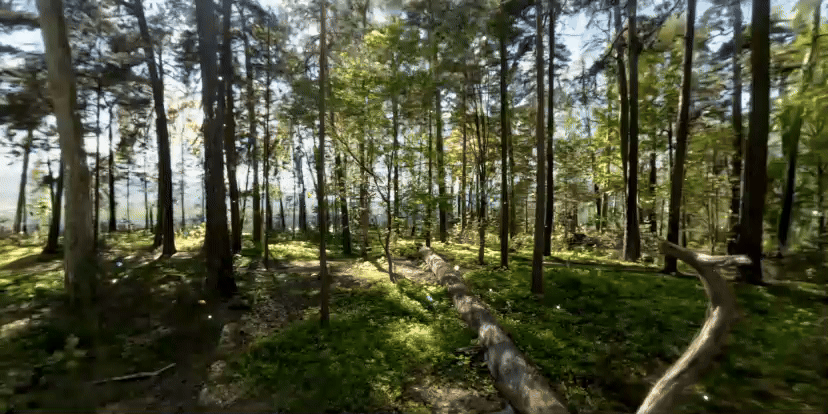

# Digital Garden — Quest 3 Passthrough 360° Video



A Meta Quest 3 mixed-reality experience: you stand in your real room (passthrough), a
world-space **Start** button appears in front of you, and pressing it (controller, hand
pinch, or just looking at it) smoothly fades a 360° video in over your surroundings —
optionally preceded by a "scan reveal" intro where your real room's surfaces glow with a
grid and dissolve into the video. The video can loop a configurable number of times with a
true video-over-video crossfade between plays, then fades back out to passthrough on its
own.

Built with Unity 6, URP, OpenXR, and Unity's Composition Layers package — no Meta XR Core
SDK / Oculus Integration required.

## Backstory

This project started as an experiment with [Aras Pranckevičius' Unity Gaussian Splatting
implementation](https://github.com/aras-p/UnityGaussianSplatting): importing a real-world
point-cloud capture (a park scan) as a `GaussianSplatAsset` and rendering it in VR. It looked
great in the Editor, but a detailed outdoor splat scene was too heavy to run well on Quest 3's
mobile GPU.

Rather than fight that performance ceiling, the project pivoted to something that reads as
similarly "impossible" in VR but is actually cheap to render: a pre-recorded 360° video
composited directly over passthrough via an OpenXR Equirect composition layer, with a
scan-style intro that makes the transition from your real room into the video feel
intentional rather than jarring. `GSTestScene` (the original splat demo) and the splat
tooling are still here and still work — see [Gaussian Splatting demo](#gaussian-splatting-demo-gstestscene)
below — but the finished, polished experience is `PassThroughVideoScene`.

## Requirements

- Unity **6000.3.23f1** (see `ProjectSettings/ProjectVersion.txt`)
- A Meta Quest 3 (or Quest 3S) for testing — passthrough and the Composition Layers /
  Scene API features used here need real Quest hardware, not just the Editor
- Android Build Support module installed in Unity
- DX12 or Vulkan if you ever try the Editor/Standalone path (**DX11 is not supported** by the
  Gaussian Splatting package's compute shaders); Quest builds are Vulkan/Android regardless

## Getting started

1. Clone the repo and open it with Unity Hub (it should offer to install the matching editor
   version automatically).
2. **Supply a 360° video** — see the next section, the repo doesn't ship one.
3. Open `Assets/PassThroughVideoScene.unity`.
4. `File > Build Settings` → Android → Build (or Build And Run with a Quest connected over
   USB/ADB).
5. Put on the headset, look around, walk up to the Start button and select it.

### Supplying your own 360° video

Video files are **not** included in this repo (the ones used during development were
187MB–1.1GB; GitHub rejects anything over 100MB and this project deliberately doesn't use Git
LFS). To use your own:

1. Drop an equirectangular 360° `.mp4` anywhere under `Assets/` (any resolution — the video's
   `RenderTexture` auto-resizes to match whatever clip you assign, no manual setup).
2. Select `Assets/ImmersiveVideo/Config/ImmersiveVideoConfig.asset` and drag your clip onto its
   **Video Clip** field. If you have a second video file for the loop-crossfade layer, that's
   wired up separately — see [`ImmersiveVideoDirector`](#the-state-machine-immersivevideodirectorcs) below;
   by default both layers play the same clip.
3. Press Play in the Editor or make a new build. If your file has the *same name* as one of
   the (gitignored) clips that used to live here, it'll even pick up the same import GUID —
   the `.meta` files for the removed clips are kept in the repo on purpose.

### Gaussian Splatting demo (`GSTestScene`)

The original splat demo needs its own imported point-cloud asset too (also excluded — the
compressed splat data was over 1GB). To try it:

1. Get a `.ply` or `.spz` Gaussian Splat capture (e.g. export one from
   [Polycam](https://poly.cam/) or a similar capture tool, or use a public sample dataset).
2. In the Editor: `Tools > Gaussian Splats > Create GaussianSplatAsset`, point it at your
   file, and let it generate the `GaussianSplatAsset` + sidecar `.bytes` files.
3. Add a `GaussianSplatRenderer` component to a GameObject in `GSTestScene` and assign the
   generated asset.
4. See the [upstream repo's README](https://github.com/aras-p/UnityGaussianSplatting#readme)
   for compression format tradeoffs if you want to tune it for standalone-headset performance
   (the copy vendored at `Packages/org.nesnausk.gaussian-splatting/` doesn't include them).

Fair warning, from experience: dense/large outdoor captures are exactly what struggled on
Quest 3 in the first place — this repo's own `PassThroughVideoScene` pivot exists because of
that.

## What's actually implemented

- **Passthrough → video fade**: a `ColorScaleBiasExtension`-driven alpha fade on an OpenXR
  Equirect composition layer, composited under Unity's Default Scene Layer and over a Meta
  Passthrough layer. No lighting/shader tricks — the compositor does the blending.
- **World-space Start button**, selectable three independent ways, any of which can be
  disabled without touching the others:
  - uGUI `Button` via a `TrackedDeviceGraphicRaycaster`-driven controller ray (Unity XR
    Interaction Toolkit's own Starter Assets `NearFarInteractor` prefabs — no hand-rolled
    input polling)
  - Hand pinch, via OpenXR's `Hand Interaction Profile` (`XR_EXT_hand_interaction`) — works
    without installing `com.unity.xr.hands` for the interaction itself; that package is
    still used separately to get the Android hand-tracking permissions/manifest entries and
    the Hands Interaction Demo's hand visuals
  - **Gaze dwell** (`GazeDwellButton.cs`): look at the button for ~1.5s. Deliberately
    independent of the Input System/XRI/EventSystem chain entirely, so it keeps working even
    if a controller/hand binding ever breaks — kept as a permanent third option, not just a
    debug fallback
  - The button follows your head loosely (only recenters if it drifts far out of view for a
    while, not every frame) and always spawns facing wherever you're currently looking
- **Scan-reveal intro** (optional, `IntroMode.ScanReveal`): captures your room's real
  geometry (AR mesh → AR planes → a procedural proxy room, first tier that succeeds) as a
  one-time snapshot, then a custom shader (`SceneRevealSurface.shader`) makes those surfaces
  glow with an expanding grid wave and materialize into the video before a final dissolve
  handoff to the real composition layer. Falls back to a plain fade if scene geometry can't be
  acquired. Off by default (`IntroMode.SimpleFade`) so a fresh clone gets the simpler, more
  reliable path first.
- **Video always opens facing you**: at the moment Start is pressed, the video layer's
  yaw is rotated to match your current gaze direction (plus an optional fixed offset), so the
  video's "front" is never a surprise regardless of which way you were facing.
- **Configurable repeat playback with a real crossfade**: the video can play back-to-back
  `N` times before Outro. For `N > 1`, a second, normally-hidden composition layer
  (`VideoLayerB`) dissolves the outgoing play into the next one — genuine video-over-video,
  passthrough is never exposed mid-loop. Falls back gracefully to a same-layer dip if the
  second layer isn't set up. Audio crossfades in sync with the video.
- **Outro**: fades out shortly before the (last) play's natural end rather than after it
  freezes on a dead last frame, waits for a live passthrough camera frame before revealing it
  (avoids a black gap), then returns to Idle so Start can be pressed again — a full repeatable
  cycle, not a one-shot.

## Architecture

### Composition layers (back to front)

```
Order -3   PassthroughLayer   (Meta Passthrough)
Order -2   VideoLayerB        (crossfade helper — hidden unless mid-transition)
Order -1   VideoLayer         (the video you normally see)
Order  0   Default Scene Layer (Unity's own rendered scene: the Start button, scan-reveal surfaces, etc.)
```

`VideoLayerB` exists purely to make the loop-replay transition a dissolve instead of a hard
cut — see `ImmersiveVideoDirector.AdvanceToNextPass` for exactly how the two layers hand off
to each other (only `VideoLayer`'s own alpha ever animates; `VideoLayerB`'s alpha is set once
and left alone, since it only needs to be "fully opaque before it's revealed").

### The state machine (`ImmersiveVideoDirector.cs`)

```
Booting → Warmup → Idle ⇄ (Intro → Playing → Outro) → Idle → ...
```

`Warmup` runs once (Scene-API permission + geometry acquisition + video prepare, in
parallel). After that, `Idle → Intro → Playing → Outro → Idle` repeats every time Start is
pressed — this is a resumable loop, not a one-shot experience.

### Project structure

```
Assets/ImmersiveVideo/
  Config/
    ImmersiveVideoConfig.cs        ScriptableObject with every tunable (timings, curves,
                                    button placement, crossfade/repeat settings, ...)
  Runtime/
    ImmersiveVideoDirector.cs      The state machine described above
    PanoramicVideoPlayer.cs        Thin VideoPlayer wrapper (prepare/play/pause, no
                                    composition-layer knowledge)
    CompositionLayerFader.cs       Animates a layer's alpha via ColorScaleBiasExtension
    SceneGeometryProvider.cs       AR mesh/planes/proxy-room tier resolution for the
                                    scan-reveal intro
    ScanRevealDirector.cs          Scan → materialize → dissolve phase timeline
    IdleController.cs              Positions/shows/hides the Start button, dispatches
                                    StartRequested regardless of which input triggered it
    GazeDwellButton.cs             Input-device-independent gaze-dwell trigger
    ControllerInteractionDriver.cs, HandInteractionDriver.cs
                                    Earlier hand-rolled input polling, superseded by XRI's
                                    own Starter Assets interactor prefabs - kept for
                                    reference, disabled in the scene
    XRInputDump.cs                 Dev-build-only diagnostic: dumps every live Input System
                                    device + OpenXR extension list to logcat
    Spike/FadeSpike.cs             Early throwaway spike that proved the compositor-level
                                    fade on-device - superseded by CompositionLayerFader
  Spike/TestEquirect.png           Test texture used by the fade spike's setup command
  Shaders/SceneRevealSurface.shader  Scan-reveal surface material (equirect-samples the
                                      video texture directly, so revealed surfaces show
                                      exactly what the video layer will show once it fades in)
  Editor/                          Idempotent `ImmersiveVideo/...` menu commands that build
                                    the scene hierarchy via Unity's own GameObject-creation
                                    menu items rather than hand-authoring components - safe
                                    to re-run

Packages/org.nesnausk.gaussian-splatting/
                                    Vendored copy of the Gaussian Splatting package (MIT,
                                    © Aras Pranckevičius) this project's own Packages/manifest.json
                                    depends on locally, so this repo builds standalone
                                    without needing the upstream repo alongside it.
```

Every `Editor/ImmersiveVideo*.cs` script (the `*Setup.cs` ones plus
`ImmersiveVideoInputActionsFix.cs`) is a `[MenuItem("ImmersiveVideo/...")]` command
(check the Unity menu bar) — they were how the whole scene was actually built, incrementally,
rather than by hand-editing scene YAML. Re-running one is safe; each checks what already
exists before creating anything.

## Configuration reference

Everything tunable lives on `Assets/ImmersiveVideo/Config/ImmersiveVideoConfig.asset`
(inspect it directly — every field has a purpose-specific name and most have an inline
comment in `ImmersiveVideoConfig.cs`). Highlights:

| Field | What it controls |
|---|---|
| `introMode` | `SimpleFade` (default) or `ScanReveal` |
| `videoStartYawOffsetDegrees` | Fixed rotation applied on top of your gaze when the video opens |
| `videoPlayCount` | How many times the video plays before Outro (1 = original single-play behavior) |
| `loopCrossfadeSeconds` | Duration of the video-over-video dissolve between plays |
| `outroLeadSeconds` | Outro starts this many seconds before the *final* play's natural end |
| `sceneRevealYawCalibrationDegrees` | Per-device calibration for the scan-reveal surface's manual equirect sampling vs. the native compositor's UV convention — tune by eye in-headset if you change the video |
| `buttonDistance`, `buttonHeightOffsetDeg`, `buttonDiameter` | Start button placement |
| `allowProxyRoomFallback`, `proxyRoomSize` | What the scan-reveal intro shows if real room geometry can't be captured |

## Known limitations / not implemented

These were deliberately scoped out, not overlooked:

- No error panel UI for failed video prepare/playback (`ImmersiveVideoDirector.RetryAfterFailure`
  is exposed as the hook a future Retry button would call)
- No pause/resume-on-app-lifecycle handling
- No recenter-to-current-position handler beyond the Start button's own gaze-following
- `OutroMode.ReverseScan` and `ReplayIntroMode.Shortened` are declared but fall back to their
  simpler siblings (stubbed, not silently ignored)
- Early-exit (long-press to skip playback) has a config flag (`allowEarlyExit`,
  `earlyExitHoldSeconds`) and a public `RequestEarlyExit()` hook, but no input binding wired
  up to actually call it yet

## Credits

- [Aras Pranckevičius' Unity Gaussian Splatting](https://github.com/aras-p/UnityGaussianSplatting)
  (MIT) — vendored at `Packages/org.nesnausk.gaussian-splatting/`
- Unity's [XR Interaction Toolkit Starter Assets](https://docs.unity3d.com/Packages/com.unity.xr.interaction.toolkit@latest)
  sample — the controller ray interactor prefabs used here
- Built entirely against public Unity/OpenXR/AR Foundation APIs — no Meta XR Core SDK /
  Oculus Integration dependency

## License

MIT — see `LICENSE.md`. The vendored Gaussian Splatting package under `Packages/` carries its
own MIT license file from the original author.
